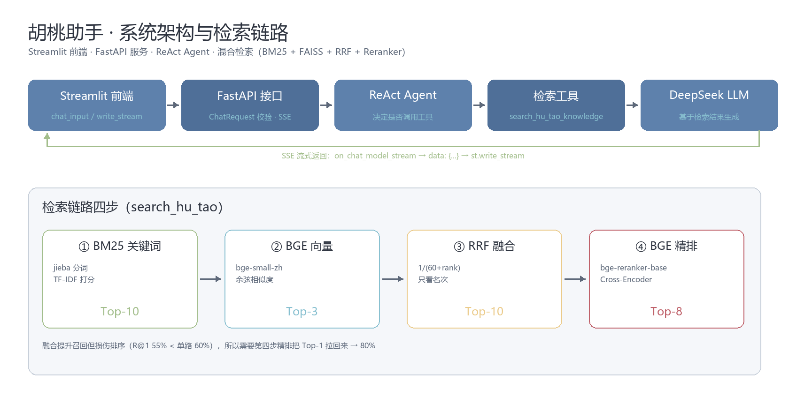
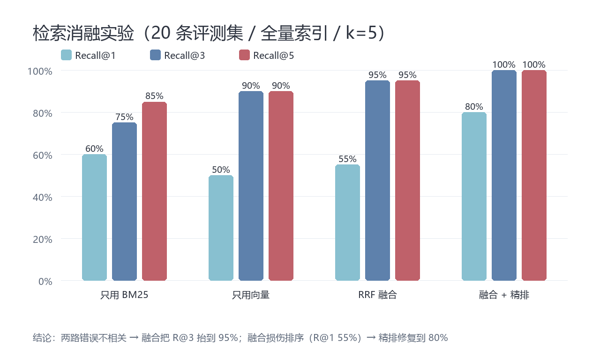

# 胡桃助手 (Hu Tao Assistant) - 基于 RAG 与 ReAct Agent 的角色问答系统

## 📖 项目简介
基于混合检索（BM25 + 向量检索）与 ReAct Agent 架构的原神角色问答系统。项目脱离了纯框架依赖，从零手写了 BM25、RRF 融合算法以及安全的 AST 求值器，并引入了 BGE-Reranker 精排，通过自建评测集完成了 RAG 链路的量化调优。



**一句话看懂**：前端提问 → FastAPI 校验 → Agent 决定是否调工具 → 检索四步（BM25 / 向量 / RRF 融合 / 精排）→ 大模型基于检索结果作答 → SSE 流式吐字。

## 🛠 技术栈
- **核心语言**：Python 3.10+
- **大模型 API**：DeepSeek API (通过 langchain-openai 接入)
- **检索与向量**：手写 BM25、RRF、FAISS、BGE-small-zh (Embedding)、BGE-Reranker (精排)
- **Web 与安全**：FastAPI, Streamlit, AST (安全求值)
- **数据库**：SQLite, SQLAlchemy (用于持久化记忆)

## ✨ 核心亮点
1. **手写底层算法**：脱离 LangChain 封装，纯手写中文分词、BM25 打分以及 RRF 融合算法，深刻理解检索底层原理。
2. **三级检索漏斗**：结合 BM25 与 BGE 向量粗排召回，通过 RRF 融合，最后利用 BGE-Reranker (Cross-Encoder) 进行二次精排，大幅提升上下文质量。
3. **数据驱动的调优**：建立 20 条标准评测集（覆盖人物设定、故事背景、角色评价），跑通 4 组消融对照，**Recall@3 达到 100%、Recall@1 达到 80%**；并自查修正了旧评测脚本的 Recall@1 口径错误（曾误报 90%）。
4. **Agent 智能路由与安全**：基于 ReAct 模式自主调用工具；彻底废弃不安全的 `eval()`，基于 `ast` 模块手写安全求值器，杜绝代码注入与 DoS 风险。

## 🏗 系统架构流程
1. 用户提问通过 FastAPI/Streamlit 传入后端。
2. Agent 接收 Prompt 与工具列表，判断是否需要调用工具。
3. 若需要检索，Agent 调用 `search_hu_tao_knowledge` 工具。
4. 检索器串行执行：
   - BM25 进行关键词倒排检索。
   - FAISS 进行 BGE 向量语义检索。
   - 使用 RRF 算法对两路结果进行融合（粗排）。
   - 使用 BGE-Reranker 对 Top-N 候选集重新打分排序（精排）。
5. 检索结果与用户问题拼接，交回大模型生成最终回答（ReAct 循环设有最大步数限制）。

## 📊 消融实验（20 条评测集 / 全量索引 / k=5）



| 配置 | Recall@1 | Recall@3 | Recall@5 | 平均延迟 |
| --- | --- | --- | --- | --- |
| 只用 BM25（关键词） | 60% | 75% | 85% | 0.038s |
| 只用 BGE 向量（语义） | 50% | 90% | 90% | 0.007s |
| RRF 融合（不精排） | 55% | 95% | 95% | 0.006s |
| **RRF + BGE-Reranker（线上）** | **80%** | **100%** | **100%** | 0.799s |

复现：`python eval/run_ablation.py`。结论：两路召回互补（BM25 擅精确匹配、向量擅同义改写），
融合把 Recall@3 从 75%/90% 抬到 95%，Cross-Encoder 精排再把 Recall@1 从 55% 抬到 80%，
代价是单次查询多约 0.8s——用延迟换 Top-1 准确度，对"只把前几条塞进 prompt"的场景是划算的。

## 🎛 参数消融：为什么是这些值

| 参数 | 试过的值 | 结论 |
| --- | --- | --- |
| `BM25_TOP_K` | 3 / 5 / 10 / 20 | Recall@3 全部 100%，Recall@1 的差异只有 1 题（=5 个百分点，属波动）→ 取 10 是"够用且不过度" |
| `FAISS_TOP_K` | 1 / 3 / 10 | 1 → R@3 95%；**3 → 100%**；10 → 又掉回 95%——融合池固定 10 条，一路给多了会挤掉另一路的候选 |
| `RERANK_CANDIDATES` | 3 / 5 / 10 | 3、5 → R@3 95%；**10 → 100%**——好答案可能排在第 6-10 位，池子小了精排根本看不到它 |
| `min_score` | 0 ~ 2 | 取 **0.5**：域外问题 5/5 全部被过滤，域内 20 题只丢 1 题（`q006`「你是谁」，本来就不该走检索） |

复现：`python eval/run_param_ablation.py`

**一个必须写在明面上的局限**：20 条评测集里，**1 道题的差异就是 5 个百分点**。所以上表里 85% 和 80% 的差距是 1 题波动，不能当成"参数改进了"；只有差异超过 2 题才值得当信号。

**一次自我纠正**：我第一版脚本用"域内最低分 vs 域外最高分"判断阈值可不可分，结论是"两组重叠、无法分离"。
但把逐题分数打出来后才发现，重叠只来自 `q006` 这**一道寒暄题**——它本来就不需要检索。
排除它之后，0.5 这个阈值可以做到"域外全滤、域内只丢这一题"。
**粗看统计量会得出错误结论，必须看逐条数据。**

## ✂️ 切分策略消融

命中口径与切分无关：检索返回的某一块是否**完整覆盖**标准答案 70% 以上的词。
「答案密度」= Top-1 块里与标准答案重叠的词占该块总词数的比例，用来衡量块里混了多少无关内容。

| 切分策略 | 块数 | 平均长度 | 长块结尾不完整率 | Recall@1 | Recall@3 | Top-1 答案密度 |
| --- | --- | --- | --- | --- | --- | --- |
| 统一 150 / overlap 30 | 66 | 118 | **42%** | 55% | 80% | 64.0% |
| 统一 250 / overlap 50 | 40 | 200 | 31% | 75% | 100% | 44.0% |
| 统一 300 / overlap 50 | 33 | 232 | 25% | **90%** | 100% | 46.4% |
| **长短分开（线上）** | 81 | 91 | 27% | 80% | 100% | **83.4%** |

复现：`python eval/run_chunk_ablation.py`

**三条结论：**

1. **块越小越容易腰斩**：统一 150 时 42% 的长块结尾停在半句上，Recall@3 掉到 80%。
2. **覆盖率类指标天然偏爱大块**：统一 300 的 Recall@1 最高（90%），因为它把多条台词合并成一块，
   一块里塞了 3-4 条内容，几乎任何问题都能"碰到"答案词——指标好看，但 Top-1 答案密度只有 46%，
   **一半以上是无关内容**，塞进 prompt 就会让回答发散。这就是"chunk 250 时命中率虚高"的真正原因。
3. **选切分不能只看 Recall**，要同时看答案密度。线上方案 Recall@1 是 80%（比统一 300 低 10 个点），
   但答案密度 83.4%，是唯一"块里基本没有噪音"的方案——对"只把前几条塞进 prompt"的场景，这个更重要。


1. **Embedding 模型的演进**：初版使用 `chinese-roberta` 直接生成向量，发现完全不具备语义检索能力。通过消融实验确认后，替换为专为检索优化的 `BGE-small-zh`。
2. **切分策略的调优**：
   - 初始 `chunk_size=250`：切分过大，混入多条无关台词，噪音极大。
   - 调整 `chunk_size=150`：统一切分导致长故事文本腰斩，Recall@3 跌至 30%。
   - **最终方案**：引入定制策略。短文本（台词/评价）按 `\n\n` 严格切分；长文本（故事）采用 `chunk_size=300, overlap=50`。
3. **精排模型的引入**：单路召回都到不了 100%——只用 BM25 的 Recall@3 是 75%，只用向量是 90%，RRF 融合后是 95%。引入 `bge-reranker-base` 对融合候选做 Cross-Encoder 精排后，**Recall@1 从 55% 提升到 80%，Recall@3 从 95% 提升到 100%**。
4. **计算器工具的漏洞**：早期采用 `eval()` 配合白名单，存在 `9**9**9` 的 DoS 攻击风险。后重构为基于 `ast` 的安全求值器，拦截了所有非四则运算节点。
   但"拦截了攻击"不等于"安全"——后来用 25 条 payload 打自己的求值器，又发现三处遗留问题：
   **① `bool` 是 `int` 的子类**，`True+True` 会被算成 2，说明"只允许数字"这条规则其实没生效；
   **② 浮点溢出不会抛异常**，`1e309`、`1e308*10` 会静默返回 `inf`，而 `inf` 进 `json.dumps` 会产出非标准的 `Infinity`，前端 `JSON.parse` 直接失败；
   **③ 白名单是按"值类型"而不是"字面量形式"判断的**，`0x10`、`1_000_000` 也被接受（无害但不严谨）。
   三条都已修，并补了回归测试（`tests/test_utils.py`）。
5. **评测脚本的 Recall 口径错误**：`is_hit()` 里截断的是 `expected_doc_ids[:k]` 而不是 `retrieved_ids[:k]`，导致"Recall@1"实际判定成了"Top-5 是否命中"，把 80% 报成了 90%。自查发现后修正了截断位置，并补了 `eval/run_ablation.py` 做组件级对照。
6. **doc_id 依赖切分上下文**：早期 `doc_id = f"{文件名}_{批次内全局序号}"`，同一块内容在"全量切分"和"分类切分"下编号不同，甚至出现 `他人对胡桃的评价_25` 实际指向另一个文件的情况。改为"文件名 + 文件内序号"后编号与上下文无关，并加了索引/知识库一致性护栏。
7. **启动耗时 80s → 4s**：embedding 与 reranker 原本在 `import` 阶段加载，导致 uvicorn 冷启动要等 70 多秒。改为懒加载 + 索引/BM25 进程内缓存后，`import rag_build` 从 76s 降到 0.09s，`import main_api` 从 80s 降到 4s，单次检索也不再重复构建 BM25。
   **但懒加载只是把成本转移了**：第一个检索请求要自己承担 ~10s 的模型加载（实测冷启动后首个 RAG 请求 13.97s，第二个回到 3.8s）。所以又加了「启动后后台预热线程 + `/health` 的 `models_ready` 就绪探针」：预热完成后首请求降到 **3.82s**；就绪探针保证负载均衡不会在预热期间导流——实测预热期间到达的请求要等 **22.4s**，比不加预热还慢。

## 🧪 生成侧评测（检索指标之外）

`Recall@k` 只说明"正确材料被找出来了"，不说明"模型答对了"。补一个便宜的代理指标：

```bash
python eval/run_answer_eval.py            # 跑完整 Agent 链路 20 条（消耗 API 额度）
python eval/refine_answer_eval.py         # 重算统计、生成人工评分表（不调用 API）
```

| 指标 | 数值 |
| --- | --- |
| 样本数 | 20（其中 4 条为寒暄类，不含实体） |
| 平均实体覆盖率（全部） | 60.5% |
| 平均实体覆盖率（排除寒暄） | **66.8%** |
| 拒答 / 报错 | 0 / 0 |
| 平均端到端延迟 | 4.38s |

**这个数字不是准确率，别拿它当准确率用。** 实体覆盖率只说明"金标准文档里的名词有没有出现在回答里"，
回答可能名词都对但逻辑答偏。所以同时生成了 `eval/answers_review.md`（人工三档评分表），
真实准确率要人工填完才有。

> 顺带一个指标陷阱：第一版拒答检测用子串匹配 "不知道"，把原台词「你不知道吗，往生堂第七十七代堂主就是胡桃我啦」
> 误判成拒答。改成"第一人称不知道 / 无法回答"的正则后误判归零。**指标本身也需要被检验。**


```bash
# 全量（需要本地模型，约 20s）
python -m unittest discover -s tests -t . -v

# 只跑纯逻辑测试（无需模型/密钥，CI 里跑的就是这批）
python -m unittest tests.test_bm25 tests.test_utils -v
```

| 测试文件 | 覆盖内容 | 依赖 |
| --- | --- | --- |
| `tests/test_bm25.py` | jieba 分词过滤、TF/DF 计数、BM25 打分与排序、RRF 公式（`1/(k+rank)`）与"分数被忽略"语义 | 仅 jieba |
| `tests/test_utils.py` | AST 求值器：四则/取余/整除、除零、拒绝 `**`、拒绝代码注入、超长表达式 | 无 |
| `tests/test_api.py` | `/health` `/roll` `/time`、`/calc` 的 GET+POST 与 400 语义、`/chat` 的 422 校验 | FastAPI |
| `tests/test_retrieval.py` | 返回条数、doc_id 必须存在于当前切分、结果确定性、**doc_id 跨批次稳定性回归**、已知样本必命中 | BGE 模型 |

共 **34 个用例**，全绿。其中 `test_doc_id_is_stable_across_batches` 是专门为前面那个 doc_id 错位 bug 写的回归测试——
以后谁再把序号改成批次内全局序号，这条会立刻红。

CI：`.github/workflows/ci.yml`，push/PR 时自动跑不依赖模型的那两批。

## 🚀 快速复现指南

### 1. 环境准备
```bash
# 创建虚拟环境并激活
python -m venv venv
venv\Scripts\activate  # Windows
# source venv/bin/activate  # Mac/Linux

# 安装依赖
pip install -r requirements.txt
```

### 2. 模型与环境变量
```bash
下载本地模型：请先运行 python download_model.py 下载 BGE 向量模型和 Reranker 模型至本地 models/ 目录。

配置 API Key：在根目录创建 .env 文件，配置 DEEPSEEK_API_KEY=sk-xxxxxx。
```

### 3. 构建索引
```bash
# 首次运行 / 修改 knowledge/ 下任何文档后都要执行
python scripts/rebuild_index.py
```
> 索引与知识库不一致时检索会直接报错提示重建，避免静默返回错内容。

### 4. 启动服务
```bash
# 启动 Agent 控制台对话 (CLI)
python main.py

# 启动后端 API 
uvicorn main_api:app --reload

# 启动前端 Web 界面
streamlit run app.py

# 跑检索评测 / 消融实验
python eval/run_retrieval_eval.py
python eval/run_ablation.py
```